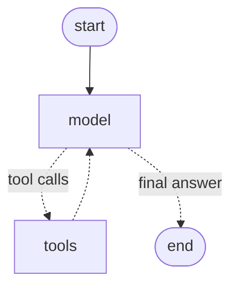
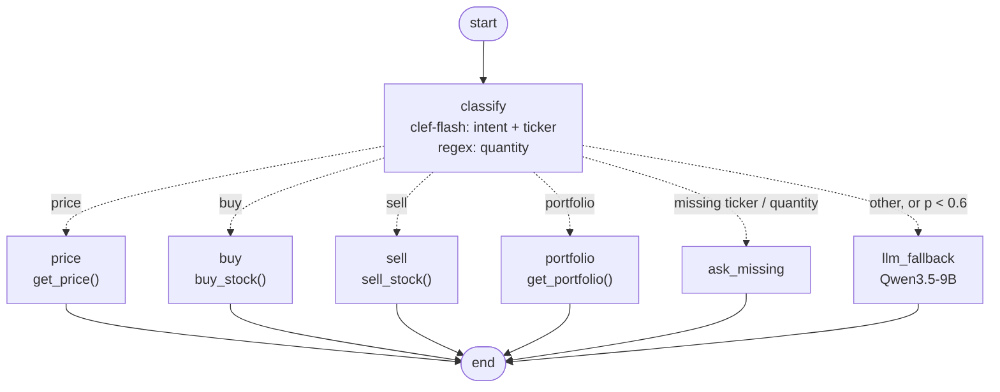
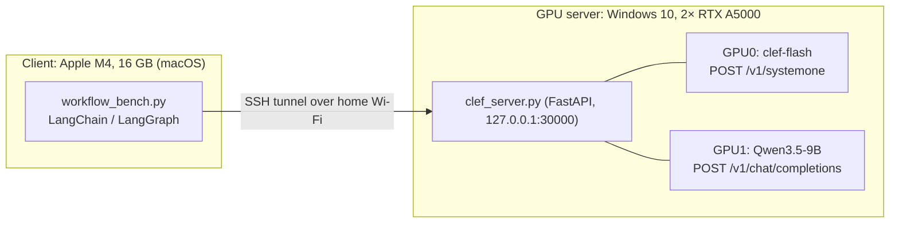

# clef-langchain-bench

**A local decision model as the router of a LangChain/LangGraph workflow, compared with a classic tool-calling agent.**

Agentic workflows are flexible but slow, so many teams fall back to hand-written scripts with keyword rules. Those rules are brittle: "hisse" (stock) appears in both *"buy 100 lots of THY"* and *"what is a stock?"*. This repo measures a middle path:

- **[Cloudflare/clef-flash](https://huggingface.co/Cloudflare/clef-flash)** (9B decision model) reads the request and returns calibrated probabilities for typed questions (intent, ticker) in a single forward pass. It generates no text.
- **Code** runs the matching tool deterministically and formats the reply.
- **An LLM agent** handles only the open-ended requests (or anything clef is unsure about).

Everything runs locally on two consumer/workstation GPUs. Clef speaks the Jev/SystemOne API, so the stock [`langchain-typesafe`](https://pypi.org/project/langchain-typesafe/) client and its middleware work against it unchanged; the only change is setting `TYPESAFE_BASE_URL`.

## Results at a glance

Turkish stock-brokerage workflow, 15 requests × 3 runs, same tools, same LLM (Qwen3.5-9B, thinking off):

| | **clef-routed graph** | **tool-calling agent** |
|---|---|---|
| Correct (all runs) | **45/45** | 39/45 |
| Tool requests (11), median latency | **0.27 s** | 7.20 s |
| Open-ended requests (4), median latency | **5.64 s** | 13.14 s |
| Sum of per-request medians (15 requests) | **25.2 s** | 124.2 s |

- On requests that map to a tool, the clef route was **~27× faster** (median 0.27 s vs 7.20 s).
- The agent failed 2 requests in all 3 runs by answering **without calling the tool and inventing a price**:
  *"Koç Holding şu an kaç lira?"* → "185,40 TL" (backend price: 198.75); *"Garanti hisselerimi satmayacağım, sadece fiyatına bakacaktım"* → "10.45 TL" (backend: 131.90). In the clef route, prices always come from code.
- Both approaches handled the traps correctly: *"Hisse senedi nedir?"* ("what is a stock?") and *"Aselsan alınır mı sence?"* ("should I buy Aselsan?") executed no order; *"I won't sell, I just wanted the price"* became a price lookup in the clef route (p=0.92), where a keyword rule would have matched "sat" (sell).

Full per-request table: [`results/workflow/summary.md`](results/workflow/summary.md). Raw runs with replies: [`results/workflow/results.json`](results/workflow/results.json).

## The two graphs

**A) Tool-calling agent** — `langchain.agents.create_agent` (exported from the compiled graph). The LLM decides on every step:



**B) Clef-routed workflow** — a LangGraph `StateGraph`. One clef call answers two questions; code does the rest:



The graphs are generated by the benchmark itself: [`results/workflow/graph_agent.mmd`](results/workflow/graph_agent.mmd), [`results/workflow/graph_clef.mmd`](results/workflow/graph_clef.mmd).

The single clef call behind `classify`:

```python
from langchain_typesafe import Choice, TypeSafeClassifier

classifier = TypeSafeClassifier()  # TYPESAFE_BASE_URL=http://127.0.0.1:30000
answers = classifier.invoke({
    "state": "Türk Hava Yollarından 100 lot al",
    "questions": {
        "intent": Choice(instructions="What does the user want the brokerage system to do right now?",
                         criteria={"price": "...", "buy": "...", "sell": "...", "portfolio": "...", "other": "..."}),
        "ticker": Choice(instructions="Which stock does the message refer to?",
                         criteria={"THYAO": "Türk Hava Yolları", "GARAN": "Garanti BBVA", ..., "none": "No specific stock"}),
    },
}).choices
# answers["intent"].choice == "buy" (p=0.94), answers["ticker"].choice == "THYAO"
```

## Setup



| | |
|---|---|
| **GPU server** | Intel Core i9-10920X (12 cores / 24 threads), 128 GB RAM, 2× NVIDIA RTX A5000 24 GB (PCIe 3.0 ×16, 230 W), NVIDIA driver 596.86 (WDDM), Windows 10 Pro |
| **Server software** | Python 3.12.10, PyTorch 2.11.0+cu128, transformers 5.10.2, accelerate 1.15.0, FastAPI/uvicorn |
| **Models** | clef-flash, BF16, GPU0 (17.8 GiB) · Qwen3.5-9B, BF16, GPU1 (17.5 GiB) · greedy decoding |
| **Client** | Apple M4, 16 GB, Python 3.12, LangChain 1.4.4, LangGraph 1.2.14, langchain-openai 1.7.0, langchain-typesafe 0.0.1a3 |
| **Network** | SSH local port forward over home Wi-Fi; all latencies are end to end from the client |

`flash-linear-attention` and `causal-conv1d` were **not** installed (they need a CUDA toolchain on Windows), so both Qwen3.5-based models ran on transformers' pure-PyTorch fallback. That slows both sides; Qwen decoded at ~12–17 tokens/s.

`server/clef_server.py` exposes:

- `POST /v1/systemone` — Jev/SystemOne-compatible decisions (clef-flash), usable by `TypeSafeClassifier`, `ModelRouterMiddleware`, `AutoModeMiddleware`.
- `POST /v1/chat/completions` — OpenAI-compatible chat with tool calling (Qwen3.5-9B). Model names: `qwen-fast` (thinking off), `qwen-think` (thinking on; reasoning is force-closed at its token budget so it cannot loop forever).

## Second benchmark: decision model vs. generative LLM on classification

10 short classification cases (support routing, sarcasm, phishing vs. a legitimate GitHub email, a Turkish complaint, news topic, banking intent, toxicity, NLI, log severity), 15 questions in total:

| Model / mode | Correct | Latency per case | Load | Notes |
|---|---|---|---|---|
| **clef-flash** (1 GPU) | 14/15 | **0.23 s** | 20 s | probability per option; mean p(gold) 0.853 |
| **[clef-omni](https://huggingface.co/Cloudflare/clef-omni)** (30B-A3B MoE, 2 GPUs + CPU offload) | **15/15** | 5.8 s | 67 s | mean p(gold) 0.928; 18 of 48 layers offloaded to CPU |
| Qwen3.5-9B, thinking off, JSON answer | **15/15** | 1.07 s | 14 s | ~14 output tokens |
| Qwen3.5-9B, thinking on, JSON answer | 10/15 | 72.9 s | 14 s | ~1250 tokens of reasoning; looped to the 4096-token cap on 2 cases and never answered |

- clef-flash missed only sarcasm detection (p=0.45 for "sarcastic").
- clef-omni does not fit two 24 GB cards in BF16, so `server/clef_omni_loader.py` loads it with `device_map="auto"`, moves the joint-schema head's inputs to the head's device, and reloads `lm_head` from safetensors when accelerate offloads it to the `meta` device. Copying offloaded layers on every forward pass explains the 5.8 s.
- clef-omni also answered from audio only (two synthesized voicemails) and from images; see [`results/classification/omni.log`](results/classification/omni.log).

Results: [`results/classification/`](results/classification/). Note: the summary line in `llm.log` reports 25/30 for thinking mode; that was a bug in the summary filter (now fixed in `server/bench_llm_baseline.py`). The per-case lines and `llm_results.json` give the correct 10/15.

## Reproduce

**GPU server (Windows, NVIDIA GPUs with ≥ 20 GB each):**

```bat
pip install torch==2.11.0 torchvision==0.26.0 --index-url https://download.pytorch.org/whl/cu128
pip install -r requirements-server.txt
:: copy server\*.py to %USERPROFILE%\clef, then download the models once:
python -c "from huggingface_hub import snapshot_download as s; s('Cloudflare/clef-flash'); s('Qwen/Qwen3.5-9B')"
```

Windows OpenSSH Server must be enabled. The server listens on `127.0.0.1` only and is reached through the SSH tunnel.

**Client (macOS/Linux):**

```sh
python3.12 -m venv .venv && .venv/bin/pip install -r requirements-client.txt
export CLEF_HOST=user@your-gpu-box
scripts/start_server.sh        # terminal 1: tunnel + server, Ctrl+C stops both
.venv/bin/python client/workflow_bench.py --repeats 3   # terminal 2
```

The classification benchmark runs on the GPU server itself: `python bench_classification.py` (clef-flash, then clef-omni) and `python bench_llm_baseline.py` (Qwen3.5-9B).

## Limitations

- **Small, hand-written test sets** (15 + 15 questions) written by the author, Turkish requests in the workflow benchmark. Read the results as a demonstration of the pattern, not as a general accuracy claim. See the [Decision Index](https://clef-evals.workers-ai-mle.workers.dev) for broad evaluations.
- **The clef route only covers predefined workflows.** Adding a workflow means writing code, and clef cannot extract free-form values: quantities come from a regex here, a long ticker list would need narrowing first.
- **Templated replies.** The clef route answers with fixed strings; the agent writes more natural text.
- **One machine, no kernel optimizations**, Wi-Fi in the loop. Absolute numbers will differ on other hardware or with an optimized server such as SGLang; the relative gap comes from one forward pass vs. several generation calls.
- The agent uses a 9B open model. A frontier model would likely not invent the prices, but would add API latency and cost to every step.

## License

MIT for the code in this repository. The models have their own licenses: clef-flash, clef-omni and Qwen3.5-9B are Apache-2.0.
